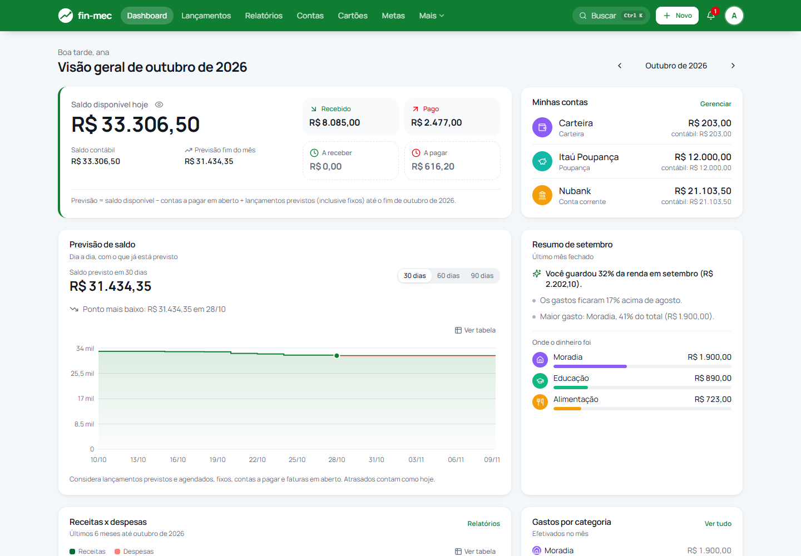
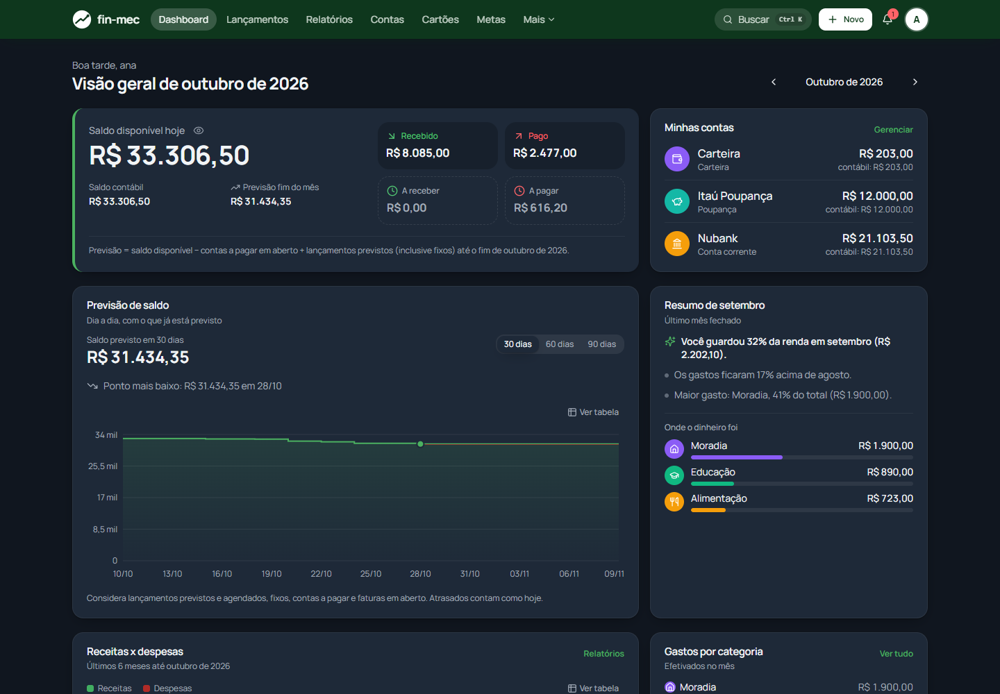
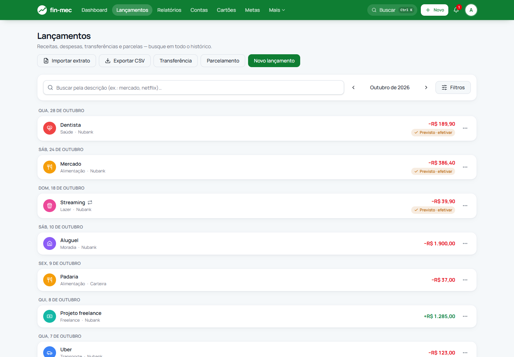
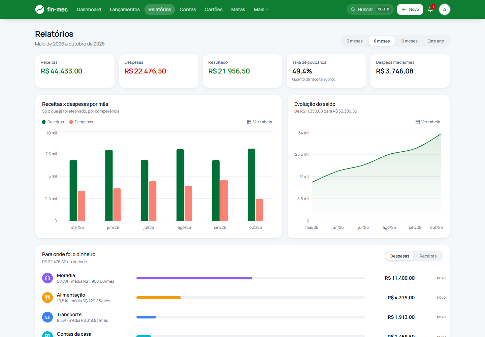
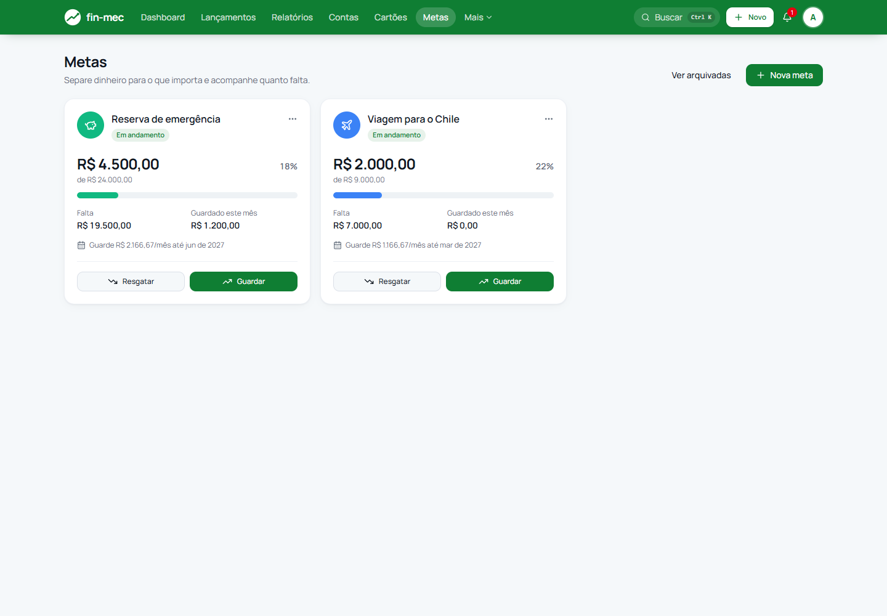

# fin-mec

Gerenciador de finanças pessoais e familiares: contas, lançamentos, cartão de crédito com fatura,
orçamento por categoria, contas a pagar, metas, relatórios, importação de extrato e Open Finance.
Usa o [Organizze](https://www.organizze.com.br) como produto de referência, mas a stack e a
arquitetura foram construídas do zero.

**Stack:** Java 21 · Spring Boot 4.1 · Spring Security 7 · PostgreSQL 18 · Flyway · React 19 ·
TypeScript · Vite · TanStack Query · Tailwind 4 · Testcontainers · Docker · Caddy



<table>
  <tr>
    <td width="30%"></td>
    <td></td>
  </tr>
</table>

<details>
<summary>Mais telas: lançamentos, relatórios e metas</summary>





</details>

As telas usam dados fictícios de demonstração.

## O que ele faz

| Área | Funcionalidades |
|---|---|
| Dia a dia | Contas, receitas/despesas/transferências, parcelamento, lançamentos fixos gerados automaticamente, tags, comprovantes anexados |
| Cartão de crédito | Faturas por ciclo de fechamento, compras parceladas, pagamento de fatura integrado ao saldo |
| Planejamento | Orçamento por categoria/mês, contas a pagar recorrentes, metas de economia, previsão de saldo |
| Análise | Dashboard (saldo contábil e disponível), fluxo de caixa, evolução do saldo, ranking por categoria com variação contra o período anterior, resumo mensal, alertas |
| Entrada de dados | Importação OFX/CSV com prévia, deduplicação e regras de categorização; sincronização bancária via Pluggy (Open Finance) |
| Compartilhamento | Household com convite de membros (casal/família) e registro de quem lançou |
| Segurança e privacidade | 2FA TOTP com códigos de recuperação, bloqueio por tentativas, revogação de sessões, recuperação de senha por e-mail, exportação de dados e exclusão de conta (LGPD) |
| Uso | PWA instalável com leitura offline, tema escuro, paleta de comandos, layout responsivo |

## Arquitetura

Monólito modular: um único deploy, com um pacote por domínio (`account`, `transaction`,
`creditcard`, `budget`, `bill`, `goal`, `importing`, `bankprovider`, `household`, `identity`...)
e as mesmas quatro camadas dentro de cada um:

```
com.mecfin.<módulo>
├── api           controllers REST e DTOs de entrada/saída
├── application   casos de uso, transações, orquestração
├── domain        entidades e regras de negócio
└── infra         repositórios e adapters externos (Pluggy, armazenamento, e-mail)
```

O frontend é uma SPA em `web/`. Em produção, o próprio Spring a serve (mesma origem que a API,
então não há CORS); em dev, o Vite faz proxy de `/api` para o backend.

Algumas decisões que valem a leitura:

- **Toda regra financeira fica no backend.** Saldo, fatura, status de vencimento e previsão são
  calculados no servidor e cobertos por testes de integração contra Postgres real
  (Testcontainers), não contra H2.
- **Status derivado não é persistido.** "Atrasado" é calculado na leitura a partir da data, então
  não depende de um job ter rodado.
- **Recorrência idempotente.** Os lançamentos fixos são gerados numa janela deslizante de 12
  meses. Rodar o job duas vezes não duplica nada, e editar "este e os próximos" reescreve só a
  cauda da série.
- **Importação idempotente.** Índice único por `(conta, external_id)`. Importar o mesmo extrato
  duas vezes não cria lançamentos novos, e uma linha que casa com um lançamento previsto efetiva
  o previsto em vez de duplicar.
- **Portas e adapters onde há dependência externa.** `BankProviderClient` (Pluggy),
  `AttachmentStorage` (Postgres hoje, trocável por S3) e `NotificationSource` (alertas plugáveis).
- **Sessão com cookie HttpOnly + CSRF**, sessões persistidas no Postgres (Spring Session JDBC),
  e invalidação de todas as sessões por um carimbo de segurança quando a senha ou o 2FA mudam.
- **2FA implementado sobre o RFC 6238** e validado contra os vetores de teste do próprio RFC; o
  segredo é cifrado em repouso com AES-256-GCM.

O histórico de cada fase, com o critério de pronto e a comparação com Organizze, Mobills, YNAB e
outros, está em [`docs/ROADMAP.md`](docs/ROADMAP.md).

## Rodando localmente

Requisitos: JDK 21, Node 22 e Docker.

```bash
# 1. Banco (e Mailpit, um SMTP falso com caixa de entrada em http://localhost:8025)
cp .env.example .env          # preencha DB_PASSWORD
docker compose up -d

# 2. Backend em http://localhost:8080 (perfil dev, migrations aplicadas pelo Flyway no boot)
mvn spring-boot:run

# 3. Frontend em http://localhost:5173
cd web
npm install
npm run dev
```

No perfil `dev`, a documentação da API fica em `http://localhost:8080/swagger-ui.html`. Em
produção ela fica desligada.

A integração bancária é opcional: sem `PLUGGY_CLIENT_ID`/`PLUGGY_CLIENT_SECRET` no `.env`, a tela
"Bancos conectados" fica desligada e explica como configurar.

## Testes

```bash
mvn verify                    # unitários + integração (sobe Postgres via Testcontainers)
cd web && npm test            # Vitest
cd web && npm run lint && npm run typecheck
```

O backend tem mais de 300 testes. Os de integração rodam contra Postgres de verdade, com
`ddl-auto: validate` ligado, para que uma divergência entre entidade e migration quebre o build e
não o boot em produção. A CI (GitHub Actions) roda backend, frontend e o build da imagem Docker
em todo PR.

## Deploy

`docker-compose.prod.yml` sobe a aplicação atrás do Caddy (HTTPS automático), com backup diário
do Postgres (retenção configurável) e um script que testa a restauração. O passo a passo e o
checklist de segurança estão em [`docs/DEPLOY.md`](docs/DEPLOY.md).
